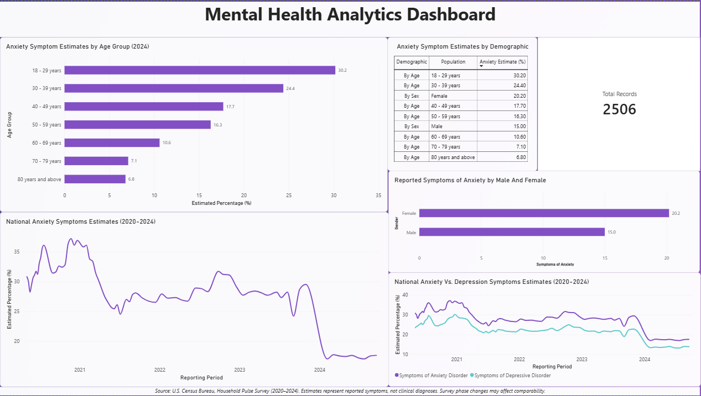

# Mental Health Analytics Dashboard

### U.S. Mental Health Trends | 2020–2024

## Project Overview

This project explores trends in reported anxiety and depressive symptoms in the United States using data from the U.S. Census Bureau's Household Pulse Survey.

I independently developed a Power BI dashboard to visualize changes in mental health symptom estimates over time and compare reported symptoms across demographic groups.

The goal was to practice data cleaning, data visualization, and exploratory analysis while creating an accessible dashboard that communicates meaningful patterns.

## Dashboard Preview

## Tools & Technologies

- **Microsoft Power BI** — Interactive dashboards and data visualization
- **Power Query** — Data cleaning and transformation
- **CSV** — Source data
- **GitHub** — Project documentation and portfolio hosting

## Dataset

**Source:** U.S. Census Bureau — Household Pulse Survey

**Reporting Period:** 2020–2024

The dataset contains estimated percentages of adults reporting symptoms of anxiety and depression, categorized by reporting period and demographic characteristics.

## Data Cleaning & Preparation

I used Power Query to prepare the dataset for visualization.

Key steps included:

- Reviewing and addressing missing values.
- Removing repeated header rows.
- Correcting inconsistent data types.
- Filtering demographic categories relevant to the analysis.
- Creating a custom column to distinguish potentially misrepresented survey phase identifiers.
- Verifying reporting dates and investigating unexpected changes in the data.

## Dashboard Features

**1. Anxiety Symptoms by Sex**

Compares estimated anxiety symptom prevalence between male and female populations.

**2. Anxiety Symptoms by Age Group**

Examines how anxiety symptom estimates differ across age categories.

**3. National Anxiety Trends (2020–2024)**

Visualizes changes in national anxiety symptom estimates across reporting periods.

**4. Anxiety vs. Depression Trends**

Compares national estimates of anxiety and depressive symptoms over time.

**5. Demographic Comparison**

Provides a table comparing anxiety symptom estimates across age and sex categories.

**6. Total Records KPI**

Displays the number of records included in the prepared dataset.

## Key Findings

- Adults aged 18–29 displayed the highest anxiety symptom estimates among the age groups analyzed.
- Female populations showed higher anxiety symptom estimates than male populations in the selected reporting period.
- Anxiety symptom estimates generally exceeded depressive symptom estimates throughout the displayed timeline.
- A substantial decline was observed between late 2023 and early 2024, coinciding with a change in survey reporting phases.

**Limitation:** Changes in survey methodology or reporting may affect comparisons across phases. The observed decline should not be interpreted as a confirmed reduction in population-level anxiety or depression without further validation.

## Skills Demonstrated

- Data cleaning and transformation
- Data type validation
- Power Query custom columns
- Data filtering and aggregation
- Time-series visualization
- Demographic comparisons
- Dashboard design
- Exploratory data analysis
- Data interpretation

## Project Files

- `Mental_Health_Analytics_Dashboard.pbix` — Interactive Power BI dashboard
- `dashboard-preview.png` — Dashboard screenshot
- `README.md` — Project documentation

## Data Source

[U.S. Census Bureau — Household Pulse Survey](https://www.census.gov/data/experimental-data-products/household-pulse-survey.html)

*This project is intended for exploratory data analysis and visualization. Reported symptoms do not necessarily indicate a clinical diagnosis.*
